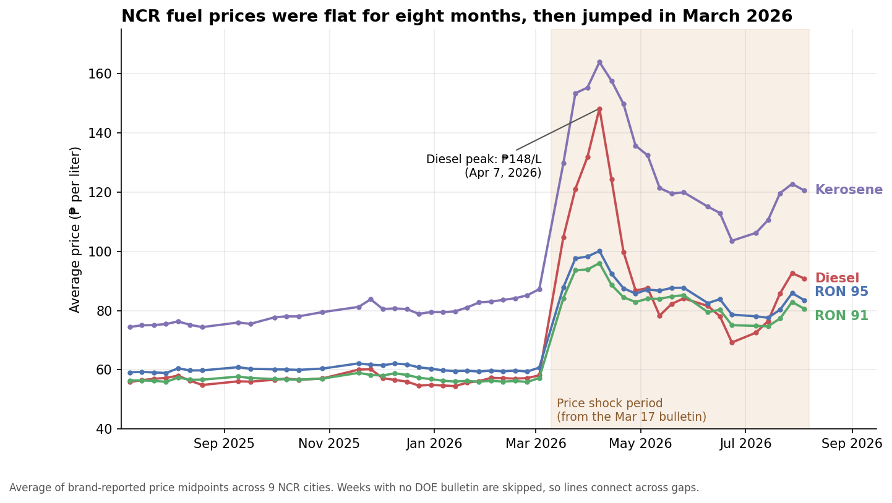

# Philippine Fuel Price Data Pipeline

An end-to-end data engineering project that turns the Department of Energy's weekly Metro Manila fuel price bulletins (PDFs) into a clean dataset, a small set of KPIs, and plain-language insights.

**The question:** How have Philippine retail fuel prices (gasoline, diesel, kerosene) changed over time, and how do they vary by region and fuel type?

**Headline result:** NCR fuel prices were flat for eight months, then jumped in March 2026. Diesel went from about ₱58 per liter (Mar 3) to a peak of ₱148 (Apr 7), and was still 60% above its old level on Aug 4, 2026. Read the one-page [stakeholder brief](docs/stakeholder_brief.pdf) for the plain-language version.



## Contents

- [Quick start](#quick-start)
- [How the pipeline works](#how-the-pipeline-works)
- [Repository layout](#repository-layout)
- [Key findings](#key-findings)
- [Data source](#data-source)
- [Data processing](#data-processing)
- [Schema plan](#schema-plan)
- [SQL business questions](#sql-business-questions)
- [KPIs](#kpis)
- [Analysis and insights](#analysis-and-insights)
- [Limitations and next steps](#limitations-and-next-steps)

## Quick start

Requires Python 3.10 or newer (developed on 3.13).

```bash
git clone https://github.com/credough/dep-data-engineering-open-track-aaron-celindro.git
cd dep-data-engineering-open-track-aaron-celindro

python -m venv .venv
source .venv/bin/activate          # Windows: .venv\Scripts\activate
pip install -r requirements.txt

python scripts/run_pipeline.py --skip-ingest
```

That last command works **offline and without any credentials**: the downloaded bulletins are already in `data/raw/`, so it re-parses them and rebuilds the dataset, KPIs and segment tables. Then open the notebooks in `notebooks/` to see the charts.

| Command | What it does |
|---|---|
| `python scripts/run_pipeline.py` | Full run: download bulletins, parse, KPIs, segments (a few minutes, needs internet) |
| `python scripts/run_pipeline.py --skip-ingest` | Reuse the PDFs already in `data/raw/` |
| `python scripts/run_pipeline.py --skip-ingest --skip-transform` | Only recompute KPIs and segments |
| `python scripts/run_pipeline.py --with-notebooks` | Also re-execute both notebooks |
| `python scripts/run_pipeline.py --with-db` | Also load Supabase and run the SQL questions (needs a `.env`, see below) |

The pipeline stops at the first failing step with a clear message and a non-zero exit code. Running it twice produces identical output files.

**Optional database step.** Copy `.env.example` to `.env` and set `SUPABASE_DB_URL` to your Supabase (Postgres) connection string. `.env` is git-ignored, so credentials are never committed.

## How the pipeline works

```
DOE bulletins (PDF)          data/raw/
       |  scripts/ingest.py
       v
parsed, validated table      data/processed/ncr_fuel_prices.csv
       |  scripts/transform.py
       +--> scripts/kpis.py      --> output/kpis/       5 KPIs
       +--> scripts/segments.py  --> output/segments/   4 segment comparisons
       +--> scripts/load_to_supabase.py --> Supabase --> sql/business_questions.sql   (optional)
                                    |
                      notebooks/ read the saved tables and draw output/figures/
```

Each step is its own script that reads files and writes files, so any step can be run, tested or replaced alone. The notebooks only read saved outputs, so the pipeline and the notebooks cannot disagree.

## Repository layout

```
.
├── data/
│   ├── raw/                       weekly DOE bulletins (PDF), one per week
│   └── processed/                 ncr_fuel_prices.csv: clean, long-format dataset
├── scripts/
│   ├── run_pipeline.py            run everything in order (start here)
│   ├── ingest.py                  1. download the bulletins
│   ├── transform.py               2. parse the PDFs into the clean dataset
│   ├── kpis.py                    3. compute the five KPIs
│   ├── segments.py                4. build the segment comparison tables
│   ├── load_to_supabase.py        (optional) load the CSV into Postgres
│   └── run_sql_questions.py       (optional) run sql/business_questions.sql
├── sql/business_questions.sql     SQL answering the project's business questions
├── notebooks/
│   ├── insights.ipynb             five charts, interpretations, one inference check
│   └── segmentation_and_kpis.ipynb  KPI framework and four segmentation views
├── output/
│   ├── figures/                   all charts (PNG)
│   ├── kpis/                      KPI tables (CSV)
│   └── segments/                  segment tables (CSV)
├── docs/
│   ├── KPI_DEFINITIONS.md         what each KPI means and how it is calculated
│   └── stakeholder_brief.pdf      one-page plain-language summary
├── dashboard/                     placeholder for the deployed dashboard
├── .github/workflows/pages.yml    GitHub Pages deployment workflow
├── .env.example                   template for the optional database connection
└── requirements.txt
```

## Key findings

| Question | Finding |
|---|---|
| How did prices change over time? | Nearly flat for eight months, then a sharp jump in March 2026. Diesel: ₱58.1 (Mar 3) to ₱104.8 (Mar 17) to a peak of ₱148.2 (Apr 7), and ₱90.8 on Aug 4, 2026. |
| Which fuel was hit hardest? | At the peak, diesel was 162% above its pre-shock baseline and Diesel Plus 145%, versus 59% to 71% for gasoline grades. On Aug 4 diesel was still +60% and gasoline +35% to +43%. |
| How volatile were weekly changes? | Typical week-to-week swing in diesel grew from 1.7 to 11.0 percentage points; the largest 7-day moves were +15.6% and -19.8%. |
| Do cities differ? | Only slightly: -3.2% (Marikina) to +2.5% (Pasay) against the same-week NCR average, and the pattern is similar before and during the shock. |
| Do brands differ? | More than cities, and most on premium gasoline. Shell is about +6% above the market and Flying V about -6%. Shell averages ₱7.45 per liter above independent stations for the same fuel, city and week (95% interval ₱7.11 to ₱7.77). |
| Do brand gaps grow when prices rise? | In percent they shrink; in pesos they barely move. They behave like roughly fixed peso amounts. |

## Data source

**Primary:** DOE NCR Price Monitoring bulletins (Department of Energy, Oil Industry Management Bureau), one PDF per week:
`https://prod-cms.doe.gov.ph/documents/d/guest/ncr-price-monitoring-{MMDDYYYY}-pdf`

Each bulletin holds a per-city, per-fuel, per-brand price table for Metro Manila.

- **Why this URL.** DOE's article listing pages (`doe.gov.ph/articles/...`) sit behind bot detection and could not be crawled. The PDF host `prod-cms.doe.gov.ph` was not blocked, and file names follow a predictable date pattern, so URLs are built directly instead of crawled. `robots.txt` on `doe.gov.ph` was checked and does not disallow this content. Requests are rate-limited (1.5 seconds apart) and identify themselves.
- **Not every week exists.** Nine weekly bulletins between Jul 8, 2025 and Aug 4, 2026 are missing (including Mar 10, 2026). Ingestion treats a missing week as an expected, non-fatal outcome and logs it.
- **NCR only.** Regional bulletins (Luzon, Visayas, Mindanao) use a different URL pattern and are not ingested yet.

**Considered, not used:** GlobalPetrolPrices.com's Philippines gasoline series (a national weekly aggregate) was identified as a possible cross-check, but it has no brand, city or diesel/kerosene detail and is not part of the pipeline.

## Data processing

`scripts/transform.py` parses every bulletin in `data/raw/` into one long-format table, `data/processed/ncr_fuel_prices.csv` (48 bulletins, 13,197 rows, 12 cities, 10 brands, 7 fuel types).

**Why a custom parser.** Each row in the PDF is visually split across two overlapping text lines (numbers and labels), which breaks standard table extraction. The script reads each word's exact position on the page and rebuilds rows and columns from measured coordinates.

Problems found in the source while building it, and how they are handled:

- **Format drift.** DOE shifted column positions in early 2026, then switched to a page roughly 2.4 times larger by April 2026. A parser with hard-coded coordinates silently returned zero rows. The parser now measures each PDF's own header row at runtime.
- **A ghost label in DOE's template.** Every bulletin carries a hidden duplicate "Caloocan City" label under page 2's first city, which merges into garbage text ("CMalaokoactai nC iCtyity"). It is separated at the parsing stage and backed by a whitelist of real NCR cities as a safety net.
- **Cities split across pages.** As DOE added cities (9 to 12), some cities' rows now span the page break. Rows are grouped into city blocks across the whole document, not per page.
- **Validation.** Of 13,257 parsed rows, 60 (0.45%) were dropped and logged: 12 with non-positive prices and 48 with an unrecognised city. Inverted price ranges are swapped and duplicates are flagged.
- **Load strategy.** The Supabase load truncates and reloads the table every run. An upsert alone would leave stale rows behind after a parser fix (this happened once during development).

## Schema plan

**Table:** `fuel_prices` (`data/processed/ncr_fuel_prices.csv`, also loaded into Supabase).
**Grain:** one row = one reported price for one **brand**, in one **city**, for one **fuel**, in one **week**.
**Primary key:** (`week_start`, `city`, `product`, `brand`).

| Column | Meaning | Type |
|---|---|---|
| `week_start` | Start date of the bulletin's coverage week | date |
| `city` | NCR city or municipality | text |
| `product` | RON 100, RON 97, RON 95, RON 91, Diesel, Diesel Plus, Kerosene | text |
| `brand` | Petron, Shell, Caltex, Phoenix, Total, Flying V, Unioil, Seaoil, PTT, Independent | text |
| `price_low`, `price_high` | Reported price range for that brand (₱ per liter) | numeric |
| `status` | `reported`, or `no_report` (the brand has an outlet but submitted no price that week) | text |

Brand-city combinations with no outlet at all are not stored, because "no outlet" and "no report" mean different things and only the latter is a gap worth tracking. Storing at the brand level keeps every roll-up (by city, fuel or week) one `GROUP BY` away.

## SQL business questions

`sql/business_questions.sql` answers four questions against the Supabase table (run with `python scripts/run_sql_questions.py`):

1. How does the average price change over time, by fuel type?
2. Which NCR city has the highest and lowest average prices?
3. Which brand is cheapest and most expensive overall?
4. Bonus: week-over-week % change by fuel (window function).

> **Caveat on questions 2 and 3.** They compare raw averages, which are biased: Marikina, Navotas and Valenzuela only appear from March 2026, when prices were already far higher, so they look dear for the wrong reason. The fair versions (each city or brand against the same-week, same-fuel average) are KPIs 4 and 5, computed in `scripts/kpis.py`.

## KPIs

Five KPIs trace back to the question. Full definitions, formulas and caveats are in [`docs/KPI_DEFINITIONS.md`](docs/KPI_DEFINITIONS.md).

| # | KPI | Output |
|---|---|---|
| 1 | NCR average price (₱ per liter), by fuel | `output/kpis/kpi_weekly_by_fuel.csv` |
| 2 | % above the pre-shock baseline | `output/kpis/kpi_weekly_by_fuel.csv` |
| 3 | Week-over-week % change (exact 7-day gaps only) | `output/kpis/kpi_weekly_by_fuel.csv` |
| 4 | City premium vs the same-week, same-fuel NCR average | `output/kpis/kpi_city_premium.csv` |
| 5 | Brand premium vs the same-city, same-week, same-fuel average | `output/kpis/kpi_brand_premium.csv` |

`output/kpis/kpi_scorecard.csv` holds a latest-and-peak snapshot per fuel, ready for a dashboard.

## Analysis and insights

- **`notebooks/insights.ipynb`** (summary statistics, five charts with an Observation / Implication / Possible Action under each, and one cautious inference check on Shell vs independent stations).
- **`notebooks/segmentation_and_kpis.ipynb`** (the KPI scorecard and four two-dimensional segmentations: fuel x month, brand x fuel, brand x period, city x period). Segment tables are saved in `output/segments/`.
- **[`docs/stakeholder_brief.pdf`](docs/stakeholder_brief.pdf)** is a one-page plain-language summary with three recommended actions for consumers and journalists.

Both notebooks read saved files only, and have their outputs embedded, so they render on GitHub without running anything.

## Limitations and next steps

**Limitations**
- NCR cities only, so "region" in the question means NCR city.
- Nine weekly bulletins are missing, so some "week-over-week" changes span two or three weeks (flagged in the KPI table).
- Prices are midpoints of DOE-reported ranges, not individual pump prices.
- The analysis describes what changed, not why. News coverage linked the March 2026 surge to the Middle East conflict, but nothing here tests causes.
- No forecasting: with 48 bulletins and a structural break in March 2026, a model would have little to learn from, and the question is descriptive.

**Next steps**
- Deploy a dashboard from `output/kpis/` and `output/segments/` to GitHub Pages (`dashboard/`).
- Ingest regional bulletins to answer the "by region" part of the question for the whole country.
- Add fair, window-function versions of SQL questions 2 and 3.
